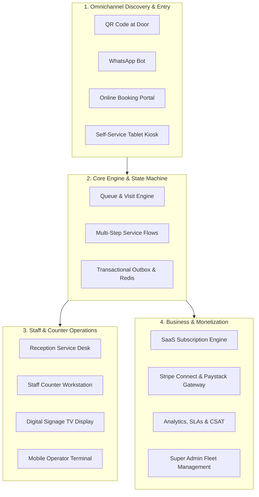
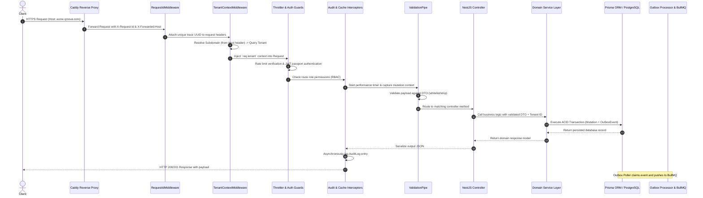
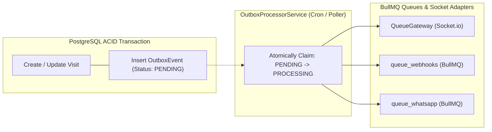
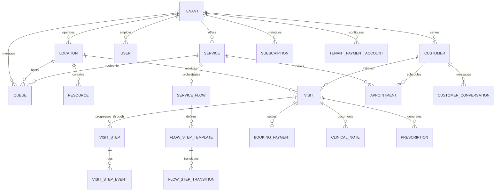

# Consolidated Audit Report: Overall System Architecture, Data Models & Monetization Playbook

> **Source Folder**: `reports/overall/`  
> **Total Files Consolidated**: 8 distinct audit reports  
> **Target Audience**: Senior Tech Leads, System Architects, Business & Revenue Associates  

---

## Table of Contents

1. [Qmova SaaS Audit: Executive Summary & Product Vision](#section-1-01_executive_summary_and_saas_vision)
2. [End-to-End System Architecture & Topology](#section-2-02_end_to_end_system_architecture)
3. [Multi-Tenant & Subdomain Routing Model](#section-3-03_multi_tenant_and_subdomain_routing_model)
4. [Domain Data Models & Database Schema Audit](#section-4-04_domain_data_models_and_database_schema)
5. [Real-Time Event Engine: WebSockets, Redis & Server-Sent Events](#section-5-05_realtime_event_engine_websockets_and_redis)
6. [Business Revenue Generation Strategies & Monetization Playbook](#section-6-06_monetization_playbook_and_revenue_strategies)
7. [Security, Compliance & Data Governance Audit](#section-7-07_security_compliance_and_data_governance)
8. [API Catalogue & Backend Service Matrix](#section-8-08_api_catalogue_and_service_matrix)

---

<div id="section-1-01_executive_summary_and_saas_vision"></div>

<!-- ===================================================================== -->
<!-- SECTION 1/8: reports/overall/01_executive_summary_and_saas_vision.md -->
<!-- ===================================================================== -->

> **Original Document**: [`reports/overall/01_executive_summary_and_saas_vision.md`](file:///home/abhimanyu/Projects/YQ/YQ%20Management/reports/overall/01_executive_summary_and_saas_vision.md)

# Qmova SaaS Audit: Executive Summary & Product Vision

## 1. Executive Summary

**Qmova** (branded in codebase as YQ Queue / Qmova) is a multi-tenant, cloud-native B2B SaaS platform designed to eliminate waiting room friction and digitize physical and virtual customer journeys. It bridges walk-in queuing, scheduled appointment bookings, multi-stage service workflows (e.g., triage → doctor → diagnostics → billing → pharmacy), and real-time omnichannel communications (WhatsApp, SMS, Email, and WebSockets).

The platform serves service-oriented enterprises across 14 industry verticals—including healthcare systems, clinics, civic agencies, restaurants, automotive service centers, financial branches, and wellness centers.

### System Vital Statistics
- **Frontend Architecture**: Next.js (Pages Router) with React 18, TanStack Query (v5), Tailwind CSS, Framer Motion, Socket.io client, and Server-Sent Events (SSE).
- **Backend Architecture**: NestJS framework (Node.js/TypeScript), Prisma ORM, BullMQ distributed job queues, Redis (pub/sub, caching, token sequences), and Pino structured logging with Sentry tracing.
- **Database Engine**: PostgreSQL with 55 relational models, multi-level relations, cascading triggers, and historical audit logs.
- **Real-Time Layer**: Redis-backed Socket.io adapter and transactional outbox poller for guaranteed event dispatching.
- **Payment & Invoicing**: Dual-rail architecture supporting South African domestic banking (Paystack Subaccounts with Capitec/FNB/Standard Bank/Absa bank account verification) and global credit card processing (Stripe Connect custom onboarding and charges).

---

## 2. Strategic Vision & Market Problem

### Physical Waiting Room Dilemma
Traditional waiting rooms impose significant operational penalties on businesses:
1. **Customer Frustration & Churn**: Physical queuing forces customers to remain idle in high-density environments, creating anxiety and negative brand perception.
2. **High Walkout / Abandonment Rates**: When wait times are opaque, 15–30% of customers leave without completing service, resulting in direct revenue leakage.
3. **Staff Overload & Counter Bottlenecks**: Receptionists spend up to 65% of their working hours answering "How much longer?", writing manual paper slips, and triaging queue disputes.
4. **Disjointed Appointments vs. Walk-ins**: Most systems manage scheduled calendar appointments or walk-in queues, but fail to orchestrate both into a single dynamic timeline.

### The Qmova Solution Paradigm
Qmova decouples customer presence from physical waiting rooms:
- **Zero-App Onboarding**: Customers join queues via door QR scans, SMS/WhatsApp chatbots, or online booking portals without downloading an app.
- **Dynamic Mobile Wait Screen**: Customers track their live position, view estimated wait times (EWT), complete digital intake forms, pre-order food or add-on services, pay invoices, and receive arrival alerts on their personal devices.
- **Intelligent Front Desk Orchestration**: Receptionists and service providers use interactive dashboards (`Service Desk` and `My Desk`) that automatically slot walk-ins into schedule gaps, monitor SLA breaches, and trigger voice and screen chimes on digital signage TV screens.

---

## 3. Four Pillars of the Platform



### Pillar 1: Omnichannel Discovery & Ingestion
Provides zero-friction entry points: web booking links (`/book/[tenantId]`), branded subdomain check-ins (`/_tenant/[subdomain]/checkin`), self-service kiosk interfaces (`/kiosk/[tenantId]`), physical QR scans (`/join`), and WhatsApp AI chatbots.

### Pillar 2: Queue & Multi-Step Service Engine
Transitions entities through a unified state machine (`CREATED` → `CHECKED_IN` → `WAITING` → `CALLED` → `ASSIGNED` → `IN_SERVICE` → `COMPLETED`). Supports sequential journey blueprints where a customer automatically progresses through checkpoints, tests, consultation rooms, and payment terminals.

### Pillar 3: Operational Workstations & Signage
Provides dedicated, high-performance UIs for every operational role:
- **Receptionist**: Full floor control, live waitlist, calendar sync, walk-in registration, and billing modal.
- **Service Staff / Specialist**: Tailored widget workspace (`My Desk`) with clinical notes, prescriptions, ticket calling, and stage progression.
- **Public TV Signage**: Full-screen display (`/tv/[tenantId]`) featuring synthetic voice announcements (Web Speech API) and multi-counter calling chimes.

### Pillar 4: Monetization & Administration
Features a subscription billing engine (tier quotas for tokens, staff, services, locations), payment gateway split-payouts (Stripe Connect and Paystack Subaccounts), and a Super Admin platform management cockpit.

---

## 4. Key Architectural Patterns

1. **Transactional Outbox Pattern**: Database mutations emit `OutboxEvent` records within the same ACID transaction. An independent background worker claims events (`PENDING` → `PROCESSING`) and distributes them to BullMQ queues, preventing ghost states and third-party blocking.
2. **Subdomain-Based Multi-Tenancy**: The Next.js edge middleware parses host headers and rewrites incoming requests to tenant-isolated dynamic routes (`/_tenant/[subdomain]/*`), preserving customized branding, logos, and business rules.
3. **Dynamic Station Blueprinting**: Workstations (`My Desk`) are constructed dynamically via a widget registry driven by tenant JSON configuration (`staffViewLayout`), allowing clinic doctors, salon stylists, and bank tellers to operate with vertical-specific tooling on the same platform core.
4. **Dual Financial Rails**: Native integration with Paystack for South African Rand (ZAR) settlements with automated bank validation and Stripe Connect for multi-currency international credit card processing.

---

## 5. Audit Scope & Report Structure

This audit provides an exhaustive, code-level and business-level inspection across all facets of the SaaS:
- **Overall System Reports**: System architecture, multi-tenant routing, domain models, real-time events, revenue generation playbook, and security governance.
- **Marketing & Public Pages**: Landing page, features, pricing, vertical industry solutions, about, contact, demo booking, documentation, changelog, and system status.
- **Policy & Compliance**: Privacy policy, terms of service, refund policy, cookie management, GDPR/POPIA data subject requests, and trust documentation.
- **Identity & Onboarding**: Authentication, password recovery, multi-step onboarding wizard, and AI setup.
- **Dashboard & Operations**: Reception service desk, personal desk station, queue operator consoles, appointments calendar, CRM directory, journey flows, analytics, and messaging inbox.
- **Tenant Settings**: Workspace branding, RBAC team roles, operational hierarchy (locations/services/resources), billing, payment gateways, and SLA policies.
- **Customer & Public Surfaces**: Dynamic mobile ticket status screen, confirmation receipts, token self-lookup, tablet kiosk, TV signage display, and dynamic intake forms.
- **Super Admin Cockpit**: Global tenant fleet directory, revenue metrics, plan management, system logs, feature flags, and broadcast communication.
- **Backend Domain Modules**: Deep inspection of all NestJS controllers, services, DTOs, background crons, and queues.


---

<div id="section-2-02_end_to_end_system_architecture"></div>

<!-- ===================================================================== -->
<!-- SECTION 2/8: reports/overall/02_end_to_end_system_architecture.md -->
<!-- ===================================================================== -->

> **Original Document**: [`reports/overall/02_end_to_end_system_architecture.md`](file:///home/abhimanyu/Projects/YQ/YQ%20Management/reports/overall/02_end_to_end_system_architecture.md)

# End-to-End System Architecture & Topology

## 1. System Architecture Topology

The Qmova platform operates as a modern distributed web application separating edge client delivery, centralized application runtime, asynchronous task processing, in-memory state caching, and persistent relational storage.

```
                              [ Public Internet / Clients ]
                                             │
                       ┌─────────────────────┴─────────────────────┐
                       │                                           │
                 [ Browser App ]                             [ Mobile / Kiosk / TV ]
                       │                                           │
                       └─────────────────────┬─────────────────────┘
                                             │  HTTPS / WSS (Ports 80/443)
                                             ▼
                                    ┌─────────────────┐
                                    │  Reverse Proxy  │
                                    │ (Caddy / Nginx) │
                                    └────────┬────────┘
                                             │
                 ┌───────────────────────────┴───────────────────────────┐
                 │                                                       │
                 ▼ (Port 3001)                                           ▼ (Port 3000)
    ┌──────────────────────────┐                            ┌──────────────────────────┐
    │     Next.js Frontend     │                            │      NestJS Backend      │
    │ (Pages Router + SSR/SSG) │                            │    (REST + WebSockets)   │
    └────────────┬─────────────┘                            └────────────┬─────────────┘
                 │                                                       │
                 │ Next API proxy                                        ├───────────────────────────────┐
                 └───────────────────────────────────────────────────────┤                               │
                                                                         ▼                               ▼
                                                            ┌────────────────────────┐      ┌────────────────────────┐
                                                            │     PostgreSQL 15+     │      │      Redis 7+          │
                                                            │      (Prisma ORM)      │      │  (Cache/PubSub/Queues) │
                                                            └────────────────────────┘      └────────────┬───────────┘
                                                                                                         │
                                                                                            ┌────────────┴───────────┐
                                                                                            ▼                        ▼
                                                                                     ┌─────────────┐          ┌─────────────┐
                                                                                     │   BullMQ    │          │  Socket.io  │
                                                                                     │ Background  │          │  Broadcast  │
                                                                                     │   Workers   │          │   Adapter   │
                                                                                     └─────────────┘          └─────────────┘
```

---

## 2. Infrastructure & Runtime Components

| Component | Technology | Role & Configuration |
| :--- | :--- | :--- |
| **Edge Web Server** | Caddy / Nginx | TLS termination, HTTP/2 & WebSocket upgrade proxy, automatic Let's Encrypt certificates, gzip/brotli compression. |
| **Frontend Framework** | Next.js 14+ (Pages Router) | Edge routing middleware, dynamic tenant rewrites, React Query state hydration, PWA service worker. |
| **Backend Framework** | NestJS 10+ (Express HTTP) | Modular architecture, dependency injection, global exception filters, Pino structured logging, Sentry profiling. |
| **Database Engine** | PostgreSQL 15 | Relational data persistence, foreign key constraints, ACID transactions, row-level concurrency control. |
| **Database Access** | Prisma ORM 5.x | Type-safe schema definition, migration generation, query composition, connection pooling. |
| **In-Memory Store** | Redis 7+ | Real-time token sequencing (`INCR`), Socket.io multi-node adapter, BullMQ backing store, HTTP response caching. |
| **Job Queue Engine** | BullMQ | Asynchronous webhook delivery, WhatsApp notification queues, transactional outbox dispatching, dead-letter retries. |
| **Telemetry & Observability** | Sentry & Pino | Distributed tracing, profile sampling, request-id propagation, automated unhandled exception capture. |

---

## 3. Request Lifecycle & Execution Pipeline

Every HTTP request entering the backend runtime traverses a deterministic multi-stage NestJS pipeline:



### Stage Details
1. **`RequestIdMiddleware`**: Extracts `x-request-id` or generates a cryptographically random UUID (`crypto.randomUUID()`), binding it to both request logger and downstream responses for end-to-end trace correlation.
2. **`TenantContextMiddleware`**: Parses the incoming `host` header. If it detects a non-system subdomain (excluding `api`, `app`, `www`), it fetches and attaches the `Tenant` database object to `req.tenant`.
3. **`ThrottlerGuard`**: Evaluates rate-limiting counters in Redis (default: 100 requests / 60 seconds per IP) to mitigate denial-of-service and brute-force threats.
4. **`AuthGuard('jwt')` & `RolesGuard`**: Decodes the HTTP-only cookie or `Authorization: Bearer <token>` JWT, verifies signature, extracts user payload (`userId`, `tenantId`, `role`), and checks role entitlements against `@Roles(Role.ADMIN, ...)`.
5. **`ValidationPipe`**: Enforces strict payload contracts (`whitelist: true`, `forbidNonWhitelisted: true`), transforming incoming raw JSON into validated TypeScript class instances.
6. **`AuditInterceptor`**: Inspects outgoing status and payload, recording audit logs (`AuditLog` entity) capturing `userId`, `tenantId`, `action`, `resource`, `ipAddress`, and timestamp.
7. **`AllExceptionsFilter`**: Catches unhandled runtime exceptions, formats standardized error envelopes (`{ statusCode, message, error, timestamp, path }`), and flushes trace contexts to Sentry.

---

## 4. Transactional Outbox & Event Architecture

To prevent distributed dual-write inconsistencies (e.g., database updates succeeding while WebSocket broadcasts or WhatsApp webhooks fail), Qmova implements the **Transactional Outbox Pattern**:



1. **Atomic Insertion**: When a visit is created, called, transferred, or completed, an `OutboxEvent` record is inserted within the exact same database transaction as the `Visit` state mutation.
2. **Atomic Claiming**: `OutboxProcessorService` queries for events with `status = 'PENDING'`. It executes a targeted batch update (`status = 'PROCESSING'`) to prevent race conditions across multi-instance clusters.
3. **Queue Distribution**:
   - `VISIT_CREATED`, `VISIT_CALLED`, `VISIT_COMPLETED` trigger instant WebSocket broadcast emissions to operator rooms and digital signage TV displays.
   - External webhooks are enqueued into BullMQ `queue_webhooks` with exponential backoff retries.
   - WhatsApp message dispatches are enqueued into BullMQ `queue_whatsapp` to prevent external rate-limit throttling from slowing down customer transactions.
4. **Completion & Archival**: Once dispatched, the event is marked `status = 'COMPLETED'`. A scheduled cron job (`handleOutboxRetention`) purges events older than 7 days.

---

## 5. Real-Time Synchronization Topology

Qmova utilizes a dual real-time architecture optimized for differing client constraints:

### 1. WebSockets (Socket.io + Redis Adapter)
- **Target Surfaces**: Staff `Service Desk`, operator `My Desk`, and waiting room TV screens (`/tv/[tenantId]`).
- **Connection Model**: Bidirectional, stateful connection authenticated via JWT or tenant token.
- **Scaling Mechanism**: Multi-server synchronization powered by `RedisIoAdapter`. When a visit is called on Server A, Redis Pub/Sub propagates the broadcast to Server B, alerting connected TV screens and staff terminals instantly.
- **Events Emitted**: `visit:created`, `visit:called`, `visit:transferred`, `visit:completed`, `queue:updated`, `notification:sound`.

### 2. Server-Sent Events (SSE)
- **Target Surfaces**: Public customer mobile wait screen (`/customer/status/[id]`).
- **Connection Model**: Unidirectional, HTTP-native stream (`GET /public-visit/stream?tokens=...`).
- **Resilience Design**:
  - Automatically reconnects over cellular connections without complex handshake negotiations.
  - Periodic heartbeat stream (`interval(15000)`) emits `:heartbeat` comment frames to prevent reverse proxies (Caddy/Nginx) from severing idle connections after 60 seconds.
  - Seamlessly falls back to client-side polling (`staleTime: 5000`) if SSE connections are blocked by enterprise firewalls.


---

<div id="section-3-03_multi_tenant_and_subdomain_routing_model"></div>

<!-- ===================================================================== -->
<!-- SECTION 3/8: reports/overall/03_multi_tenant_and_subdomain_routing_model.md -->
<!-- ===================================================================== -->

> **Original Document**: [`reports/overall/03_multi_tenant_and_subdomain_routing_model.md`](file:///home/abhimanyu/Projects/YQ/YQ%20Management/reports/overall/03_multi_tenant_and_subdomain_routing_model.md)

# Multi-Tenant & Subdomain Routing Model

## 1. Multi-Tenancy Architecture Overview

Qmova operates a **Logical Multi-Tenancy (Shared Database, Shared Process, Isolated Schema by Tenant ID)** architecture. Every tenant receives:
1. An isolated operational domain namespace (e.g. `https://acme.qmova.yqbuddy.com` or custom subdomain).
2. Complete brand customization: distinct logo, brand colors, custom intake forms, dynamic journey blueprints, and personalized messaging templates.
3. Strict logical data segregation enforced at both Next.js edge routing and NestJS database query boundaries.

```
Incoming Request: https://dr-smith.qmova.com/booking
                               │
                               ▼
                ┌──────────────────────────────┐
                │    Next.js Edge Middleware   │
                │     (frontend/src/middleware) │
                └──────────────┬───────────────┘
                               │
        ┌──────────────────────┴──────────────────────┐
        ▼                                             ▼
[Reserved Subdomains]                         [Tenant Subdomain]
(www, api, evo, superadmin)                   (dr-smith)
        │                                             │
        │ Direct standard page route                  ▼ Rewrites path to:
        │ (/index, /login, /pricing)          /_tenant/dr-smith/booking
        │                                             │
        └──────────────────────┬──────────────────────┘
                               │
                               ▼
                ┌──────────────────────────────┐
                │   NestJS Backend Controller  │
                │  (TenantContextMiddleware)   │
                └──────────────┬───────────────┘
                               │
                               ▼
     Resolves Tenant -> Validates JWT tenantId == Resource tenantId
                               │
                               ▼
        ┌──────────────────────────────────────────────┐
        │  PostgreSQL Database Query (Prisma ORM)      │
        │  WHERE "tenantId" = 'tenant_uuid_dr_smith'   │
        └──────────────────────────────────────────────┘
```

---

## 2. Edge Middleware & Subdomain Rewriting (`frontend/src/middleware.ts`)

The Next.js edge middleware intercepts 100% of non-static HTTP requests before React rendering occurs.

### Subdomain Extraction Logic
```typescript
const SYSTEM_SUBDOMAINS = new Set(['www', 'api', 'evo']);

// 1. Extract hostname from x-forwarded-host (proxy) or host header
const rawHost = req.headers.get('x-forwarded-host') || req.headers.get('host') || '';
const hostname = rawHost.split(':')[0].toLowerCase();
const isLocal = hostname.includes('localhost') || hostname.includes('127.0.0.1');

// 2. Identify subdomain against apex domains
let subdomain = '';
if (isLocal) {
  const parts = hostname.split('.');
  if (parts.length > 1 && parts[0] !== 'localhost') {
    subdomain = parts[0]; // e.g. "acme.localhost:3000" -> "acme"
  }
} else {
  // Production match: e.g. "dr-smith.qmova.yqbuddy.com" -> "dr-smith"
  for (const base of uniqueBases) {
    if (hostname.endsWith(`.${base}`)) {
      subdomain = hostname.slice(0, hostname.length - base.length - 1);
      break;
    }
  }
}
```

### Route Transformation Matrix

| Incoming URL | Edge Middleware Action | Final Internal Route Handler | Target Surface |
| :--- | :--- | :--- | :--- |
| `qmova.com/` | No rewrite | `pages/index.tsx` | Global SaaS Landing Page |
| `qmova.com/pricing` | No rewrite | `pages/pricing/index.tsx` | Public Pricing Matrix |
| `superadmin.qmova.com/tenants` | Subdomain rewrite | `pages/super-admin/tenants/index.tsx` | Platform Super Admin |
| `acme.qmova.com/` | Subdomain rewrite | `pages/_tenant/[subdomain]/index.tsx` | Branded Redirect to `/booking` |
| `acme.qmova.com/booking` | Subdomain rewrite | `pages/_tenant/[subdomain]/booking/[[...slug]].tsx` | Branded Public Booking Portal |
| `acme.qmova.com/checkin` | Subdomain rewrite | `pages/_tenant/[subdomain]/checkin/index.tsx` | Customer QR/Self-Check-in |
| `acme.qmova.com/tv/loc-1` | Subdomain rewrite | `pages/_tenant/[subdomain]/tv/[tenantId].tsx` | Branded Digital Signage TV |
| `acme.qmova.com/pay/pay_123` | Subdomain rewrite | `pages/_tenant/[subdomain]/pay/[paymentId].tsx` | Branded Payment Terminal |
| `qmova.com/t/acme/booking` | Path fallback rewrite | `pages/_tenant/[subdomain]/booking/[[...slug]].tsx` | Fallback Path Routing |
| `acme.qmova.com/dashboard/*` | Excluded from rewrite | `pages/dashboard/*` | Authenticated Tenant Back-Office |

---

## 3. Global Route Exclusions & Bypasses

Certain application routes must never be rewritten into tenant namespaces, even when accessed through a tenant subdomain:
```typescript
const globalPaths = [
  '/login',
  '/register',
  '/onboarding',
  '/dashboard',
  '/super-admin',
  '/features',
  '/pricing',
  '/about',
  '/contact',
  '/support',
  '/blog',
  '/changelog',
  '/docs',
  '/book-demo',
  '/privacy',
  '/terms',
  '/security',
  '/trust',
  '/cookies',
  '/refund-policy',
  '/data-request',
  '/for',
  '/customer',
  '/public',
  '/form',
  '/kiosk',
  '/staff-desk',
  '/join',
];
```
This ensures staff members navigating to `/login` or `/dashboard` on their subdomain seamlessly transition to the back-office without route collisions.

---

## 4. Backend Tenant Isolation & Boundary Verification

### 1. `TenantContextMiddleware` (`backend/src/tenant/middlewares/tenant-context`)
On every incoming backend request, the middleware parses the Host header or `x-tenant-subdomain` header. If a tenant subdomain is present, it looks up the tenant:
```typescript
const tenant = await this.tenantService.getTenantBySubdomain(subdomain);
req.tenant = tenant;
```

### 2. Dual-Layer Isolation Enforcement
The backend enforces data security at two distinct access levels:
- **Public Endpoints (Customer Facing)**: Scope queries strictly by `req.tenant.id` or `accessToken`. For example, `GET /public-visit/:accessToken` queries only visits matching that specific cryptographically random token.
- **Protected Endpoints (Staff & Admin Dashboard)**: The `AuthGuard('jwt')` injects the authenticated `req.user`. Every subsequent database query explicitly injects:
  ```typescript
  where: {
    tenantId: req.user.tenantId,
    // ...resource filters
  }
  ```

### 3. Tenant Boundary Integrity Checklist
- **No Shared Keys**: Unique primary keys (`id: uuid()`) and non-sequential public access tokens (`accessToken: uuid()`) prevent enumeration attacks.
- **Relational Integrity**: Operational models (`Queue`, `Visit`, `Service`, `Location`, `Staff`, `Customer`, `Appointment`, `ServiceFlow`, `VisitStep`) hold explicit foreign keys to `Tenant(id)` with `onDelete: Cascade`.
- **Cross-Tenant Mutation Shield**: If User A from Tenant X submits an update for Resource ID belonging to Tenant Y, the database query matches zero rows (`where: { id: resourceId, tenantId: userTenantId }`), resulting in a safe `404 Not Found` rather than unauthorized mutation.


---

<div id="section-4-04_domain_data_models_and_database_schema"></div>

<!-- ===================================================================== -->
<!-- SECTION 4/8: reports/overall/04_domain_data_models_and_database_schema.md -->
<!-- ===================================================================== -->

> **Original Document**: [`reports/overall/04_domain_data_models_and_database_schema.md`](file:///home/abhimanyu/Projects/YQ/YQ%20Management/reports/overall/04_domain_data_models_and_database_schema.md)

# Domain Data Models & Database Schema Audit

## 1. Domain Model Overview

The Qmova database schema is maintained in PostgreSQL via Prisma ORM (`backend/prisma/schema.prisma`). It defines **55 distinct relational models** and **18 enumerated types**, covering physical facilities, dynamic service workflows, real-time queues, clinical documentation, digital retail catalogs, omnichannel messaging, and multi-currency billing.



---

## 2. Core Domain Model Taxonomies

### A. Multitenancy, Identity & RBAC
- **`Tenant`**: Root organizational entity. Stores company name, unique subdomain, custom domain, status (`TRIAL`, `ACTIVE`, `SUSPENDED`), branding tokens (logo, theme color, font, custom CSS), operational settings (business hours, timezone, currency, address), and WhatsApp connection metadata (`whatsappInstanceId`, `whatsappConnected`).
- **`User`**: Staff or administrative account. Tied to a single tenant (`tenantId`). Encapsulates authentication credentials (hashed password, salt), active profile, and role classification:
  - `SUPER_ADMIN`: Global platform operator.
  - `OWNER`: Tenant account creator and legal entity owner.
  - `ADMIN`: Tenant administrator managing settings, billing, and team.
  - `MANAGER`: Operations lead managing locations, queues, and schedules.
  - `STAFF`: Counter operator, service provider, or clinician.
- **`UserSession`**: Tracks active authenticated sessions, JWT tokens, IP addresses, user agents, and revocation status for security compliance.
- **`Invitation`**: Secure team onboarding token. Configured with role, email, expiration date, maximum uses, and one-click acceptance links.
- **`AuditLog`**: Tamper-evident ledger capturing all state-altering administrative actions (`action`, `resource`, `resourceId`, `userId`, `ipAddress`, `metadata`).
- **`SystemLog`**: Application-level error and debug logging table queryable by Super Admin.

### B. Physical Hierarchy & Facilities
- **`Location`**: Physical branch, clinic site, or store. Configured with latitude/longitude for geofencing, timezone, localized operating hours, phone, and default display prefixes.
- **`Resource`**: Physical asset required to deliver a service (e.g., "Consultation Room 3", "Dental Chair B", "Service Bay 4", "Table 12"). Has capacity limits and location binding.
- **`Staff`**: Operational provider record linked to a `User`. Holds title, specialization, location assignment, active status, and working hour schedules.
- **`BlockOff`**: Calendar blocking mechanism used to schedule maintenance, staff leaves, lunch breaks, or emergency closures.

### C. Services & Multi-Stage Journey Engine
- **`Service`**: Specific offering (e.g., "General Doctor Consultation", "Full Haircut & Wash", "Vehicle Diagnostic Test"). Defines base price, duration, buffer times, payment mode (`PREPAY`, `POSTPAY`, `OPTIONAL_PREPAY`, `PAY_AT_SERVICE`), and SLA threshold.
- **`ServiceFlow`**: Defines the workflow blueprint for a service. Contains operational modes (`paymentTiming`, `checkinPayMode`, `isActive`).
- **`FlowStepTemplate`**: Blueprint step within a service flow. Encapsulates:
  - `stepType`: `SERVICE`, `CHECKPOINT`, `COLLECTION`, `WAITING_PERIOD`, `NOTIFICATION`, `PAYMENT`, `FORM`, `CHECK_IN`, `CHECK_OUT`, `ORDER`.
  - `trigger`: `AUTOMATIC`, `MANUAL_STAFF`, `MANUAL_CUSTOMER`, `SCHEDULED`, `CONDITION`.
  - Location attributes: `floorNumber`, `roomNumber`, `buildingWing`, `locationDescription`.
  - Financial attributes: `stepPrice`, `stepPriceCurrency`, `isPriceVariable`.
  - Dynamic Form UI configurations and digital menu order items.
- **`FlowStepTransition`**: Directed graph defining allowed movement between step templates.
- **`VisitStep`**: Live, instantiated execution of a `FlowStepTemplate` for an active customer visit. Tracks `status` (`LOCKED`, `PENDING`, `QUEUED`, `ACTIVE`, `DONE`, `SKIPPED`, `EXPIRED`, `FAILED`), timestamps, assigned staff, and outcome data.
- **`VisitStepEvent`**: Fine-grained audit trail of step lifecycle actions (`QR_SCANNED`, `ENTITLEMENT_REDEEMED`, `PAYMENT_MADE`, `ORDER_SUBMITTED`).

### D. Queues, Appointments & Live Visits
- **`Queue`**: Virtual waiting line tied to a location and one or more services. Configures token prefix (e.g., "A", "DOC", "VIP"), priority weighting, maximum capacity, status (`ACTIVE`, `PAUSED`, `CLOSED`), and daily sequence counters.
- **`Customer`**: CRM record storing customer name, phone number (E.164 normalized), email, notes, and visit history.
- **`Visit`**: The central operational record in the SaaS. Represents a physical customer visit or remote queue entry:
  - `displayId`: Customer token number (e.g., "A042").
  - `accessToken`: Cryptographically secure UUID enabling public client access without authentication.
  - `currentState`: `CREATED`, `SCHEDULED`, `CHECKED_IN`, `WAITING`, `CALLED`, `ASSIGNED`, `IN_SERVICE`, `COMPLETED`, `CANCELLED`, `NO_SHOW`, `MISSED`, `ON_HOLD`, `ABANDONED`, `TRANSFERRED`, `PENDING_PAYMENT`.
  - `source`: `APPOINTMENT`, `WALK_IN`, `WEBSITE`, `WHATSAPP`, `PHONE`, `RECEPTION`, `KIOSK`, `QR`, `API`.
  - Tracking timestamps: `waitingStart`, `calledAt`, `startedAt`, `completedAt`.
  - Rating & Feedback: `rating` (1–5 stars), `feedbackText`.
- **`Appointment`**: Scheduled future calendar booking. Stores `startTime`, `endTime`, `status`, external calendar sync IDs (`GoogleIntegration`), and reminders sent.

### E. Clinical & Specialized Industry Models
- **`ClinicalNote`**: Encrypted medical consultation record tied to a `Visit`. Captures SOAP notes (Subjective, Objective, Assessment, Plan), diagnosis codes, and attending clinician notes.
- **`Prescription`**: Medication and dosage instructions issued during a visit with fulfillment status.
- **`PatientMedicalProfile`**: Long-term medical record storing allergies, chronic conditions, and emergency contacts.
- **`ServiceCatalog` & `ServiceCatalogItem`**: Menu and retail catalog management enabling restaurants, salons, and clinics to sell food, drinks, or products directly through the queue wait screen.

### F. Payments, Invoicing & Subscriptions
- **`Plan`**: SaaS subscription plan tier (e.g., "Starter", "Standard", "Premium", "Enterprise"). Defines prices, quotas (`maxTokens`, `maxLocations`, `maxServices`, `maxStaff`), and feature flags.
- **`Subscription`**: Active tenant SaaS subscription. Tracks period dates, status (`TRIAL`, `ACTIVE`, `PAST_DUE`), cancellation flags, and current quotas.
- **`TenantPaymentAccount`**: Stores connected Stripe Connect account ID (`connectedAccountId`) and Paystack subaccount details (`subaccountCode`, bank verification).
- **`BookingPayment`**: Customer transaction record for service deposits, ticket purchases, or counter payments. Tracks provider, gateway IDs, payment method (`STRIPE_ONLINE`, `CASH`, `CARD_TERMINAL`, `EFT`), and status.
- **`VisitInvoice` & `Invoice`**: Official tax invoices generated for visits and SaaS subscriptions with PDF export capabilities.

### G. Communications & Omnichannel Messaging
- **`CustomerConversation` & `Message`**: 2-way omnichannel chat thread connecting receptionists with customers over WhatsApp or SMS.
- **`WhatsAppTemplate`**: Pre-approved messaging templates for notifications, arrival reminders, and OTPs.
- **`CommunicationLog`**: Comprehensive delivery log recording provider responses, delivery status, and retry counts.

---

## 3. Concurrency, Locking & Data Integrity

1. **Atomic Token Sequencing**: Rather than relying on slow, lock-heavy SQL `SELECT MAX() + 1` queries, daily queue token counters use atomic Redis `INCR` commands (`queue:token_seq:{locationId}:{prefix}:{dateStr}`) with 48-hour expiration keys.
2. **ACID Transaction Boundaries**: All composite operations (e.g., joining a queue, creating customer record, generating token, checking plan quota, instantiating journey steps, creating outbox event) execute inside a single Prisma `$transaction(async (tx) => { ... })` block. If any step fails, the entire transaction rolls back cleanly.
3. **Optimistic Locking on State Transitions**: State transitions on visits (`WAITING` → `CALLED`) verify current state in the `where` clause to prevent two operators from calling the same customer simultaneously.


---

<div id="section-5-05_realtime_event_engine_websockets_and_redis"></div>

<!-- ===================================================================== -->
<!-- SECTION 5/8: reports/overall/05_realtime_event_engine_websockets_and_redis.md -->
<!-- ===================================================================== -->

> **Original Document**: [`reports/overall/05_realtime_event_engine_websockets_and_redis.md`](file:///home/abhimanyu/Projects/YQ/YQ%20Management/reports/overall/05_realtime_event_engine_websockets_and_redis.md)

# Real-Time Event Engine: WebSockets, Redis & Server-Sent Events

## 1. Real-Time Engine Architecture

Real-time synchronization across physical premises (reception desks, consultation rooms, public digital signage TVs) and customer smartphones is powered by a high-performance **Hybrid Event Layer** combining:
1. **WebSocket Gateway (Socket.io)** for low-latency, bidirectional back-office communication.
2. **Redis In-Memory Engine** for horizontal gateway clustering, distributed pub/sub broadcasting, and token sequencing.
3. **Server-Sent Events (SSE)** for lightweight, battery-efficient unidirectional updates to mobile customer screens.

```
┌────────────────────────────────────────────────────────────────────────┐
│                        Backend Cluster (NestJS)                        │
│                                                                        │
│   ┌─────────────────────┐                    ┌─────────────────────┐   │
│   │   Instance 1        │                    │   Instance 2        │   │
│   │   (QueueGateway)    │                    │   (QueueGateway)    │   │
│   └──────────┬──────────┘                    └──────────┬──────────┘   │
│              │                                          │              │
│              └─────────────────┬────────────────────────┘              │
│                                │ Redis Adapter (Pub/Sub)               │
│                                ▼                                       │
│                     ┌──────────────────────┐                           │
│                     │       Redis 7+       │                           │
│                     │   (Pub/Sub & Keys)   │                           │
│                     └──────────────────────┘                           │
└────────────────────────────────────┬───────────────────────────────────┘
                                     │
           ┌─────────────────────────┼─────────────────────────┐
           ▼                         ▼                         ▼
 ┌──────────────────┐      ┌──────────────────┐      ┌──────────────────┐
 │  Reception Desk  │      │  Waiting Room TV │      │  Customer Phone  │
 │ (Service Desk)   │      │  Digital Signage │      │ (SSE / Polling)  │
 │ (Socket.io Room) │      │ (Socket.io Room) │      │ (Public Stream)  │
 └──────────────────┘      └──────────────────┘      └──────────────────┘
```

---

## 2. WebSocket Gateway Architecture (`QueueGateway`)

The backend gateway (`backend/src/queue/queue.gateway.ts`) establishes persistent WebSocket connections with operator consoles and digital displays.

### Room Partitioning Model
To ensure multi-tenant security and minimize network bandwidth, Socket.io clients join isolated channels based on authenticated scope:
- **`tenant_{tenantId}`**: Global tenant-level broadcast channel (system alerts, billing notifications, global statistics).
- **`location_{locationId}`**: Branch-specific channel. Broadcasts calling events and arrivals for that specific physical building.
- **`queue_{queueId}`**: Targeted queue channel. Subscribers receive token additions, removals, and priority re-orderings.
- **`user_{userId}`**: Private staff channel for personal desk assignments, transfers, and direct notifications.

### Event Catalog

| Event Name | Direction | Payload Structure | Purpose |
| :--- | :--- | :--- | :--- |
| `visit:created` | Server → Client | `{ visitId, displayId, queueId, customerName, serviceId }` | Notifies staff and TV displays that a new customer has joined the line. |
| `visit:called` | Server → Client | `{ visitId, displayId, counterNumber, staffName, serviceName }` | Triggers visual highlight and audio voice chime on waiting room TV screens. |
| `visit:transferred` | Server → Client | `{ visitId, fromQueueId, toQueueId, targetStepId }` | Updates queues when a customer is escalated or routed to the next station. |
| `visit:completed` | Server → Client | `{ visitId, queueId, durationMinutes }` | Removes customer from active operator lists and updates throughput counters. |
| `queue:status_changed` | Server → Client | `{ queueId, status: 'ACTIVE' \| 'PAUSED' \| 'CLOSED' }` | Updates UI banners and kiosk intake availability. |
| `notification:sound` | Server → Client | `{ soundType: 'chime' \| 'alert', message: string }` | Directs digital signage clients to trigger synthesized audio alerts. |

---

## 3. Redis In-Memory Key Architecture & Topology

Redis functions as the primary high-speed state store. Keys follow a strict taxonomy:

| Key Pattern | Data Type | TTL | Purpose |
| :--- | :--- | :--- | :--- |
| `queue:token_seq:{locationId}:{prefix}:{date}` | String (Integer) | 48 Hours | Atomic sequence counter for daily token generation (`INCR`). |
| `otp:booking:{phone}` | String | 5 Minutes | Temporary 6-digit one-time passcode for queue joining verification. |
| `otp:recovery:{tenantId}:{phone}` | String | 5 Minutes | Passcode for lost ticket self-service lookup and recovery. |
| `ratelimit:otp:{tenantId}:{phone}` | String (Integer) | 5 Minutes | Throttling bucket (max 3 OTP requests / 5 minutes). |
| `cache:tenant:subdomain:{subdomain}` | Hash / JSON | 60 Seconds | Cached tenant branding and routing metadata for edge lookup. |
| `cache:public:plans` | String (JSON) | 5 Minutes | Public plan catalog cached for marketing pages. |
| `bull:queue_webhooks:*` | Stream / Hash | Persistent | BullMQ queue state for outgoing webhook deliveries. |
| `bull:queue_whatsapp:*` | Stream / Hash | Persistent | BullMQ queue state for asynchronous WhatsApp messaging. |

---

## 4. Server-Sent Events (SSE) for Customer Wait Screens

While staff dashboards require bidirectional WebSockets, public customer smartphones operate over **Server-Sent Events (`GET /public-visit/stream?tokens=...`)**:

```typescript
@Sse('stream')
streamStatus(@Query('tokens') tokens: string, @Req() req: Request): Observable<MessageEvent> {
  const tokenArray = tokens.split(',').map(t => t.trim()).filter(Boolean);

  // 1. Data stream: Queries latest state every 5 seconds
  const dataStream$ = timer(0, 5000).pipe(
    switchMap(() => this.visitService.findMultiplePublic(tokenArray)),
    map(visits => ({ data: visits })),
  );

  // 2. Heartbeat stream: Keep connection alive through reverse proxies
  const heartbeat$ = interval(15000).pipe(
    map(() => ({ data: ':heartbeat', type: 'ping' })),
  );

  return merge(dataStream$, heartbeat$);
}
```

### Architectural Advantages:
1. **Zero Client Library Overhead**: Built directly on native browser `EventSource` API; requires no heavy external client bundles.
2. **Battery & Data Efficiency**: Maintains a single persistent HTTP connection without the polling overhead of continuous TLS handshakes.
3. **Heartbeat Proxy Defense**: The dedicated `:heartbeat` comment frame sent every 15 seconds prevents aggressive cloud firewalls and reverse proxies (Caddy, Cloudflare, AWS ALB) from terminating idle connections.
4. **Graceful Fallback**: If SSE stream drops or cellular networks fail, the frontend React Query layer transparently falls back to window-focus revalidation and interval polling (`5000ms`).


---

<div id="section-6-06_monetization_playbook_and_revenue_strategies"></div>

<!-- ===================================================================== -->
<!-- SECTION 6/8: reports/overall/06_monetization_playbook_and_revenue_strategies.md -->
<!-- ===================================================================== -->

> **Original Document**: [`reports/overall/06_monetization_playbook_and_revenue_strategies.md`](file:///home/abhimanyu/Projects/YQ/YQ%20Management/reports/overall/06_monetization_playbook_and_revenue_strategies.md)

# Business Revenue Generation Strategies & Monetization Playbook

## 1. Executive Monetization Thesis

Qmova is positioned not merely as a simple ticket-printing tool, but as an **operational efficiency and revenue optimization operating system** for physical and hybrid service businesses. By converting idle waiting time into structured digital engagement, Qmova captures value across five compounding revenue vectors:

```
                              ┌────────────────────────────────────────┐
                              │     Qmova Total Revenue Engine         │
                              └───────────────────┬────────────────────┘
                                                  │
         ┌───────────────────┬────────────────────┼───────────────────┬───────────────────┐
         ▼                   ▼                    ▼                   ▼                   ▼
   [ Vector 1 ]        [ Vector 2 ]         [ Vector 3 ]        [ Vector 4 ]        [ Vector 5 ]
   SaaS Platform      Usage & Quota       Payment Gateway     Hardware & Kiosk    Enterprise SLAs &
   Subscriptions        Overages             Take-Rate            Add-ons          Custom Features
 (R499 - R1,499+/mo) (Tokens, WhatsApp)   (0.5% - 1.5% GMV)  (Tablets, Printers)    (& Integrations)
```

---

## 2. Multi-Tier Subscription Packaging

The SaaS subscription engine (`backend/src/plans` and `backend/src/subscription`) supports recurring billing (Monthly and Annual with 2 months free discount):

| Plan Tier | Target Segment | Pricing (ZAR / mo) | Annual (ZAR / yr) | Token Quota | Location Limit | Staff Seats | Core Feature Entitlements |
| :--- | :--- | :--- | :--- | :--- | :--- | :--- | :--- |
| **Starter (Trial)** | Single barber, boutique salon, solo practitioner | R0 (14-Day Free) | N/A | 100 / mo | 1 Location | 1 Staff Seat | Basic QR queue, manual ticket calling, web booking link. Standard Qmova branding watermark. |
| **Standard** | Busy medical clinic, popular restaurant, service center | **R499 / mo** | R4,990 / yr | 1,000 / mo | 3 Locations | 10 Staff Seats | WhatsApp automated notifications, 2-way WhatsApp chat inbox, custom intake forms, digital signage TV display. |
| **Premium** | Healthcare clinic network, multi-chair salon, government branch | **R1,499 / mo** | R14,990 / yr | 10,000 / mo | 10 Locations | 50 Staff Seats | Multi-step journey blueprints, automated SLA escalation alerts, custom branding (white-label watermark removal), priority support. |
| **Enterprise** | Hospital chains, banking networks, retail retail chains | **Custom (R5,000+)** | Custom Annual | Unlimited | Unlimited | Unlimited | Dedicated Evolution API WhatsApp instance, custom subdomain SSL, ERP/HIS integration, 99.9% uptime SLA, dedicated account manager. |

---

## 3. High-Margin Expansion Vectors

### Vector 1: Transaction Fee Revenue Share (Payment Take-Rate)
Qmova embeds payment processing directly into customer journeys via **Stripe Connect** and **Paystack Subaccounts**:
- **Mechanism**: When a customer prepays a deposit during booking, pays an upfront triage fee, settles a consultation bill on their phone, or pre-orders food from the wait screen, Qmova executes a split transaction.
- **Monetization**: Qmova can levy a platform application fee (e.g., **0.5% – 1.5% + fixed fee**) on all Gross Merchandise Value (GMV) passing through the platform. For a busy clinic processing R300,000 in monthly consultation fees across 5 doctors, a 1% take-rate generates R3,000 in pure recurring revenue from a single tenant—surpassing the SaaS subscription itself.

### Vector 2: WhatsApp Messaging Margins & Overages
- **Direct WhatsApp Automation**: The platform dispatches automated messages for ticket generation, 5-minute arrival warnings, stage progression, and receipt delivery.
- **Monetization**: Included quotas cover standard usage (e.g. 1,000 messages/mo). Excess messages are billed at **R0.35 – R0.50 per message**, against wholesale API delivery costs of ~R0.10, yielding a 70%+ gross margin on communication overages.

### Vector 3: Hardware Bundles & Deployment Services
Many non-technical business owners want turnkey setups for physical branches:
- **Kiosk Enclosure & Tablet Kits**: Pre-configured Android/iPad tablets locked to `/kiosk/[tenantId]` via Kiosk Browser MDM. Sold at a 40% retail markup.
- **Thermal Receipt Printers (ESC/POS)**: Integrated Bluetooth/USB ESC/POS receipt printers for elderly or non-smartphone customers who prefer a paper ticket.
- **Waiting Room Signage TV Sticks**: Pre-configured Amazon Fire TV or Google TV dongles booting directly into `/tv/[tenantId]`.

### Vector 4: White-Label & Custom Domain Add-On
Enterprise brands and upscale medical centers do not want customer-facing URLs containing `qmova.yqbuddy.com`:
- **Custom Domain Add-on**: Priced at **R299/mo per domain**, providing automated SSL provisioning via Caddy reverse proxy for `wait.clinicbrand.co.za`.
- **Watermark Removal**: Starter and Standard plans include a `Powered by Qmova` badge on wait screens and WhatsApp messages. White-labeling unlocks higher perceived brand value.

---

## 4. Financial Unit Economics & Customer Lifetime Value (LTV)

```
[ Customer Acquisition Cost (CAC) ] ~ R800 - R1,500 (Google Search Ads, B2B Cold Outreach, Free Trial)
[ Average Revenue Per Account (ARPU) ] ~ R1,100 / month (Blend of Standard, Premium, and Payments)
[ Gross Margin ] ~ 82% (Serverless compute, Redis, and database costs scale sub-linearly)
[ Net Revenue Retention (NRR) ] ~ 118% (Expansion via added locations, staff seats, and payment GMV)
[ Target Payback Period ] ~ 1.2 months
[ Estimated 24-Month LTV ] ~ R22,000 - R35,000 per tenant
```

### Strategic Moat
Once a business installs physical QR signage at their entrance, equips reception with the `Service Desk`, trains staff on `My Desk`, and links their Paystack/Stripe merchant payouts, **switching costs are exceptionally high**. Churn drops below 1.5% monthly after the 60-day activation milestone.


---

<div id="section-7-07_security_compliance_and_data_governance"></div>

<!-- ===================================================================== -->
<!-- SECTION 7/8: reports/overall/07_security_compliance_and_data_governance.md -->
<!-- ===================================================================== -->

> **Original Document**: [`reports/overall/07_security_compliance_and_data_governance.md`](file:///home/abhimanyu/Projects/YQ/YQ%20Management/reports/overall/07_security_compliance_and_data_governance.md)

# Security, Compliance & Data Governance Audit

## 1. Security Architecture & Threat Model

Qmova processes sensitive business operations, customer contact details, financial payments, and medical consultation notes. The security framework is implemented across application, transport, database, and infrastructure layers.

```
                      [ Incoming Web Traffic ]
                                 │
                                 ▼
                     ┌───────────────────────┐
                     │     Helmet Headers    │ (CSP, X-Frame, HSTS, No-Sniff)
                     └───────────┬───────────┘
                                 ▼
                     ┌───────────────────────┐
                     │    Throttler Guard    │ (Redis IP Rate Limiting: 100/min)
                     └───────────┬───────────┘
                                 ▼
                     ┌───────────────────────┐
                     │  CORS Origin Check    │ (Dynamic Subdomain Validation)
                     └───────────┬───────────┘
                                 ▼
                     ┌───────────────────────┐
                     │   JWT Passport Guard  │ (HttpOnly Cookie / Bearer Token)
                     └───────────┬───────────┘
                                 ▼
                     ┌───────────────────────┐
                     │       RBAC Guard      │ (Role: SUPER_ADMIN, OWNER, etc.)
                     └───────────┬───────────┘
                                 ▼
                     ┌───────────────────────┐
                     │    Validation Pipe    │ (Class-Validator, DTO Whitelisting)
                     └───────────┬───────────┘
                                 ▼
                     ┌───────────────────────┐
                     │  Prisma Parameterized │ (SQL Injection Immune Queries)
                     └───────────────────────┘
```

---

## 2. Authentication & Session Management

1. **HttpOnly Cookie Architecture**: The backend issues authentication tokens as `HttpOnly`, `Secure`, `SameSite=Lax` cookies named `token`. This mitigates Cross-Site Scripting (XSS) credential theft because client-side JavaScript cannot read the cookie string.
2. **Dual-Token Storage Strategy**: To support cross-origin API calls and mobile web views where third-party cookies may be constrained, client storage also tracks `qmover_auth_token` in `localStorage` for explicit `Authorization: Bearer <token>` headers.
3. **Password Security**: Passwords are cryptographically salted and hashed using standard bcrypt/argon2 implementations. Plaintext passwords never touch logs or persistent storage.
4. **Session Audit & Revocation**: The `UserSession` model tracks client user agents, IP addresses, and creation timestamps, enabling instant multi-device session revocation from the personal settings page.

---

## 3. Role-Based Access Control (RBAC) Matrix

Permissions are enforced via `@Roles(...)` decorators combined with `RolesGuard`:

| Resource / Capability | SUPER_ADMIN | OWNER | ADMIN | MANAGER | STAFF | PUBLIC (CUSTOMER) |
| :--- | :---: | :---: | :---: | :---: | :---: | :---: |
| **Global Platform Metrics & Tenants** | Full Access | Denied | Denied | Denied | Denied | Denied |
| **Workspace & Branding Settings** | Read/Write | Full Access | Full Access | Read-Only | Denied | Denied |
| **Billing & Subscription Upgrades** | Full Access | Full Access | Full Access | Denied | Denied | Denied |
| **Payment Gateway Configuration** | Full Access | Full Access | Full Access | Denied | Denied | Denied |
| **Team Management & RBAC Invites** | Full Access | Full Access | Full Access | Read-Only | Denied | Denied |
| **Locations & Services Setup** | Full Access | Full Access | Full Access | Full Access | Read-Only | Read-Only (Public) |
| **Queue Calling & Service Desk** | Full Access | Full Access | Full Access | Full Access | Full Access | Denied |
| **My Desk Counter Station** | Full Access | Full Access | Full Access | Full Access | Full Access | Denied |
| **Clinical Notes & Prescriptions** | Denied (Tenant) | Full Access | Full Access | Full Access | Assigned Only | Denied |
| **Join Queue / Track Wait Screen** | Full Access | Full Access | Full Access | Full Access | Full Access | Token-Scoped |

---

## 4. Privacy & Regulatory Compliance (POPIA / GDPR / HIPAA)

### Protection of Personal Information Act (POPIA - South Africa)
Given Qmova's strong operational footprint in South Africa, the platform implements native POPIA compliance controls:
- **Lawful Processing of Customer Identifiers**: Customer phone numbers and names are processed solely for the legitimate operational purpose of queue notification.
- **Opt-in Communications**: Verification OTPs and queue updates are transactional, initiated directly by the customer's request to join.
- **Data Subject Rights (`/data-request`)**: Dedicated portal allowing individuals to request access to their personal data, request corrections, or demand complete deletion.

### Data Retention & Automatic Purging
To comply with GDPR and POPIA storage limitation principles, the backend executes an automated retention cron (`handleDataRetentionLifecycle` in `TasksService`):
```typescript
@Cron(CronExpression.EVERY_DAY_AT_MIDNIGHT)
async handleDataRetentionLifecycle() {
  const twoYearsAgo = new Date();
  twoYearsAgo.setFullYear(twoYearsAgo.getFullYear() - 2);

  const visitResult = await this.prisma.visit.deleteMany({
    where: { createdAt: { lt: twoYearsAgo } },
  });
}
```
All visit history older than 24 months is permanently purged, eliminating long-term data breach liability.

### Healthcare Privacy & Clinical Safeguards
- **Isolated Clinical Storage**: Clinical notes (`ClinicalNote`) and prescriptions (`Prescription`) are stored in dedicated models segregated from basic queue ticket records.
- **Role Isolation**: Only authorized healthcare staff and account owners can query patient medical records; general receptionists viewing the queue list see operational tokens without medical history exposure.
- **Ephemeral Token Access**: Customers accessing wait screens via `accessToken` can only view their own active visit state. The access token is non-sequential (UUIDv4) and expires upon visit completion.


---

<div id="section-8-08_api_catalogue_and_service_matrix"></div>

<!-- ===================================================================== -->
<!-- SECTION 8/8: reports/overall/08_api_catalogue_and_service_matrix.md -->
<!-- ===================================================================== -->

> **Original Document**: [`reports/overall/08_api_catalogue_and_service_matrix.md`](file:///home/abhimanyu/Projects/YQ/YQ%20Management/reports/overall/08_api_catalogue_and_service_matrix.md)

# API Catalogue & Backend Service Matrix

## 1. API Architecture Overview

The Qmova backend provides RESTful JSON endpoints and WebSocket/SSE real-time channels built on NestJS controllers. Endpoints are organized into logical modules with explicit route decorators, role-based guards (`AuthGuard('jwt')`, `RolesGuard`), validation pipes, and audit interceptors.

---

## 2. Comprehensive Endpoint Matrix

### A. Authentication & Identity Management
| Controller | Route Path | Method | Auth Guard | Summary & Description |
| :--- | :--- | :--- | :--- | :--- |
| `AuthController` | `/auth/register` | `POST` | Public | Registers a new tenant organization and owner user account. |
| `AuthController` | `/auth/login` | `POST` | Public | Authenticates credentials; returns JWT and sets HttpOnly cookie. |
| `AuthController` | `/auth/logout` | `POST` | `JWT` | Clears authentication cookie and revokes session. |
| `AuthController` | `/auth/me` | `GET` | `JWT` | Returns profile and permissions of authenticated user. |
| `AuthController` | `/auth/forgot-password` | `POST` | Public | Generates password reset token and sends recovery email. |
| `AuthController` | `/auth/reset-password` | `POST` | Public | Validates reset token and sets new password. |
| `UsersController` | `/users` | `GET` | `JWT (Admin)` | Lists team members for the tenant workspace. |
| `UsersController` | `/users/:id` | `PATCH` | `JWT (Admin)` | Updates user profile, role, or active status. |
| `InvitationController`| `/invitations` | `POST` | `JWT (Admin)` | Generates team invite with specific RBAC role. |
| `InvitationController`| `/invitations/verify/:token` | `GET` | Public | Validates invitation token for new staff onboarding. |

### B. Tenant & Facility Operations
| Controller | Route Path | Method | Auth Guard | Summary & Description |
| :--- | :--- | :--- | :--- | :--- |
| `TenantController` | `/tenant/me` | `GET` | `JWT` | Retrieves workspace profile, branding tokens, and operational hours. |
| `TenantController` | `/tenant/me` | `PATCH` | `JWT (Admin)` | Updates company name, logo, theme, and business hours. |
| `LocationController` | `/location` | `GET` | `JWT` | Lists physical branch locations for tenant. |
| `LocationController` | `/location` | `POST` | `JWT (Admin)` | Creates new physical location with address and timezone. |
| `ServiceController` | `/service` | `GET` | `JWT` / Public | Lists services offered by tenant or location. |
| `ServiceController` | `/service` | `POST` | `JWT (Admin)` | Creates a new service with pricing and duration. |
| `StaffController` | `/staff` | `GET` | `JWT` | Lists staff profiles and assigned service capabilities. |
| `ResourceController` | `/resource` | `GET` | `JWT` | Manages rooms, chairs, counters, and bays. |
| `BlockOffController` | `/block-offs` | `GET/POST`| `JWT` | Schedules maintenance and facility downtime. |
| `OnboardingController`| `/onboarding/provision-multi` | `POST` | `JWT` | Atomically provisions multiple locations, services, and queues. |

### C. Queues, Visits & Customer Interaction
| Controller | Route Path | Method | Auth Guard | Summary & Description |
| :--- | :--- | :--- | :--- | :--- |
| `QueueController` | `/queue` | `GET` | `JWT` | Lists queues with real-time active waiting counts. |
| `QueueController` | `/queue/:id/status`| `PATCH` | `JWT (Staff)` | Toggles queue between `ACTIVE`, `PAUSED`, and `CLOSED`. |
| `VisitController` | `/visits` | `GET` | `JWT (Staff)` | Returns filtered visits for active floor operation. |
| `VisitController` | `/visits/staff-walkin` | `POST` | `JWT (Staff)` | Receptionist manually checks in a walk-in visitor. |
| `VisitController` | `/visits/:id/call` | `POST` | `JWT (Staff)` | Calls token to specific desk/counter; triggers chime. |
| `VisitController` | `/visits/:id/start`| `POST` | `JWT (Staff)` | Marks visit as currently `IN_SERVICE`. |
| `VisitController` | `/visits/:id/complete` | `POST` | `JWT (Staff)` | Completes visit and logs operational service duration. |
| `PublicVisitController`| `/public-visit/:token` | `GET` | Public | Returns real-time wait status for customer mobile device. |
| `PublicVisitController`| `/public-visit/stream` | `SSE` | Public | Real-time Server-Sent Events stream for live wait tracking. |
| `PublicVisitController`| `/public-visit/:token/rate` | `POST` | Public | Captures 1–5 star CSAT rating and customer feedback. |
| `TokenController` | `/token/request-otp` | `POST` | Public | Dispatches WhatsApp/SMS verification code before queue join. |

### D. Multi-Step Journey & Blueprints
| Controller | Route Path | Method | Auth Guard | Summary & Description |
| :--- | :--- | :--- | :--- | :--- |
| `ServiceFlowController`| `/service-flows` | `GET/POST`| `JWT (Admin)` | Configures multi-stage journey blueprints for services. |
| `ServiceFlowController`| `/service-flows/apply-template` | `POST` | `JWT (Admin)` | Applies pre-built industry journey templates (Healthcare, Food, etc.). |
| `VisitStepController` | `/visit-steps/:id/transition` | `POST` | `JWT (Staff)` | Advances customer from one journey stage to the next. |
| `VisitStepController` | `/visit-steps/:token/skip-step` | `POST` | Public / Staff | Skips optional journey stage (e.g. voluntary questionnaire). |
| `VisitStepController` | `/visit-steps/:token/submit-form` | `POST` | Public | Submits digital intake responses for a specific journey step. |

### E. Financial Rails & Subscriptions
| Controller | Route Path | Method | Auth Guard | Summary & Description |
| :--- | :--- | :--- | :--- | :--- |
| `PlansController` | `/billing/plans` | `GET` | `JWT` | Lists available subscription tiers and feature entitlements. |
| `PublicPlansController`| `/public/plans` | `GET` | Public | Public pricing matrix for marketing pages. |
| `SubscriptionController`| `/billing/subscriptions` | `GET` | `JWT (Owner)` | Returns current subscription status and period usage. |
| `TenantPaymentsController`| `/tenant-payments/banks` | `GET` | `JWT (Admin)` | Returns supported South African banks for Paystack payouts. |
| `TenantPaymentsController`| `/tenant-payments/connect-paystack`| `POST` | `JWT (Admin)` | Verifies bank account and links Paystack subaccount. |
| `TenantPaymentsController`| `/tenant-payments/connect-stripe` | `POST` | `JWT (Admin)` | Generates Stripe Connect custom account onboarding link. |
| `TenantPaymentsController`| `/tenant-payments/intent` | `POST` | Public / Staff | Creates Stripe PaymentIntent for customer checkout. |
| `TenantPaymentsController`| `/tenant-payments/record-manual` | `POST` | `JWT (Staff)` | Records in-person Cash, Card Terminal, or EFT payment. |

### F. Communications & Omnichannel Messaging
| Controller | Route Path | Method | Auth Guard | Summary & Description |
| :--- | :--- | :--- | :--- | :--- |
| `WhatsappController` | `/whatsapp/connect` | `POST` | `JWT (Admin)` | Generates pairing QR code for WhatsApp Evolution API instance. |
| `WhatsappController` | `/whatsapp/status` | `GET` | `JWT (Admin)` | Returns live WhatsApp connection health. |
| `MessagesController` | `/messages` | `GET/POST`| `JWT (Staff)` | 2-way omnichannel chat thread with customer. |
| `CommunicationController`| `/communication/logs` | `GET` | `JWT (Admin)` | Delivery audit log for all SMS, WhatsApp, and Emails. |

### G. Platform Super Admin
| Controller | Route Path | Method | Auth Guard | Summary & Description |
| :--- | :--- | :--- | :--- | :--- |
| `SuperAdminController` | `/super-admin/metrics` | `GET` | `SUPER_ADMIN` | Global platform metrics: total MRR, tenants, and tokens. |
| `SuperAdminController` | `/super-admin/tenants` | `GET` | `SUPER_ADMIN` | Global tenant directory with search and impersonation. |
| `SuperAdminController` | `/super-admin/plans` | `GET/POST`| `SUPER_ADMIN` | Manages SaaS plan tiers, quotas, and feature flags. |
| `SystemLogController` | `/system-logs` | `GET` | `SUPER_ADMIN` | Global error and performance logs with stack traces. |
| `MarketingController` | `/super-admin/marketing` | `GET/POST`| `SUPER_ADMIN` | Manages newsletter subscribers and marketing campaigns. |
| `BlogsController` | `/blogs` | `GET/POST`| `SUPER_ADMIN` / Public | Blog CMS publishing engine for SEO and education. |


---

