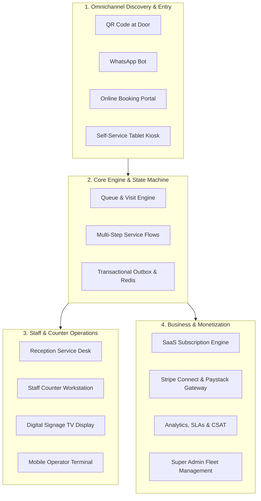

# Qmova SaaS Audit: Executive Summary & Product Vision

## 1. Executive Summary

**Qmova** (branded in codebase as YQ Queue / Qmova) is a multi-tenant, cloud-native B2B SaaS platform designed to eliminate waiting room friction and digitize physical and virtual customer journeys. It bridges walk-in queuing, scheduled appointment bookings, multi-stage service workflows (e.g., triage → doctor → diagnostics → billing → pharmacy), and real-time omnichannel communications (WhatsApp, SMS, Email, and WebSockets).

The platform serves service-oriented enterprises across 14 industry verticals—including healthcare systems, clinics, civic agencies, restaurants, automotive service centers, financial branches, and wellness centers.

### System Vital Statistics
- **Frontend Architecture**: Next.js (Pages Router) with React 18, TanStack Query (v5), Tailwind CSS, Framer Motion, Socket.io client, and Server-Sent Events (SSE).
- **Backend Architecture**: NestJS framework (Node.js/TypeScript), Prisma ORM, BullMQ distributed job queues, Redis (pub/sub, caching, token sequences), and Pino structured logging with Sentry tracing.
- **Database Engine**: PostgreSQL with 55 relational models, multi-level relations, cascading triggers, and historical audit logs.
- **Real-Time Layer**: Redis-backed Socket.io adapter and transactional outbox poller for guaranteed event dispatching.
- **Payment & Invoicing**: Dual-rail architecture supporting South African domestic banking (Paystack Subaccounts with Capitec/FNB/Standard Bank/Absa bank account verification) and global credit card processing (Stripe Connect custom onboarding and charges).

---

## 2. Strategic Vision & Market Problem

### Physical Waiting Room Dilemma
Traditional waiting rooms impose significant operational penalties on businesses:
1. **Customer Frustration & Churn**: Physical queuing forces customers to remain idle in high-density environments, creating anxiety and negative brand perception.
2. **High Walkout / Abandonment Rates**: When wait times are opaque, 15–30% of customers leave without completing service, resulting in direct revenue leakage.
3. **Staff Overload & Counter Bottlenecks**: Receptionists spend up to 65% of their working hours answering "How much longer?", writing manual paper slips, and triaging queue disputes.
4. **Disjointed Appointments vs. Walk-ins**: Most systems manage scheduled calendar appointments or walk-in queues, but fail to orchestrate both into a single dynamic timeline.

### The Qmova Solution Paradigm
Qmova decouples customer presence from physical waiting rooms:
- **Zero-App Onboarding**: Customers join queues via door QR scans, SMS/WhatsApp chatbots, or online booking portals without downloading an app.
- **Dynamic Mobile Wait Screen**: Customers track their live position, view estimated wait times (EWT), complete digital intake forms, pre-order food or add-on services, pay invoices, and receive arrival alerts on their personal devices.
- **Intelligent Front Desk Orchestration**: Receptionists and service providers use interactive dashboards (`Service Desk` and `My Desk`) that automatically slot walk-ins into schedule gaps, monitor SLA breaches, and trigger voice and screen chimes on digital signage TV screens.

---

## 3. Four Pillars of the Platform

### Pillar 1: Omnichannel Discovery & Ingestion
Provides zero-friction entry points: web booking links (`/book/[tenantId]`), branded subdomain check-ins (`/_tenant/[subdomain]/checkin`), self-service kiosk interfaces (`/kiosk/[tenantId]`), physical QR scans (`/join`), and WhatsApp AI chatbots.

### Pillar 2: Queue & Multi-Step Service Engine
Transitions entities through a unified state machine (`CREATED` → `CHECKED_IN` → `WAITING` → `CALLED` → `ASSIGNED` → `IN_SERVICE` → `COMPLETED`). Supports sequential journey blueprints where a customer automatically progresses through checkpoints, tests, consultation rooms, and payment terminals.

### Pillar 3: Operational Workstations & Signage
Provides dedicated, high-performance UIs for every operational role:
- **Receptionist**: Full floor control, live waitlist, calendar sync, walk-in registration, and billing modal.
- **Service Staff / Specialist**: Tailored widget workspace (`My Desk`) with clinical notes, prescriptions, ticket calling, and stage progression.
- **Public TV Signage**: Full-screen display (`/tv/[tenantId]`) featuring synthetic voice announcements (Web Speech API) and multi-counter calling chimes.

### Pillar 4: Monetization & Administration
Features a subscription billing engine (tier quotas for tokens, staff, services, locations), payment gateway split-payouts (Stripe Connect and Paystack Subaccounts), and a Super Admin platform management cockpit.

---

## 4. Key Architectural Patterns

1. **Transactional Outbox Pattern**: Database mutations emit `OutboxEvent` records within the same ACID transaction. An independent background worker claims events (`PENDING` → `PROCESSING`) and distributes them to BullMQ queues, preventing ghost states and third-party blocking.
2. **Subdomain-Based Multi-Tenancy**: The Next.js edge middleware parses host headers and rewrites incoming requests to tenant-isolated dynamic routes (`/_tenant/[subdomain]/*`), preserving customized branding, logos, and business rules.
3. **Dynamic Station Blueprinting**: Workstations (`My Desk`) are constructed dynamically via a widget registry driven by tenant JSON configuration (`staffViewLayout`), allowing clinic doctors, salon stylists, and bank tellers to operate with vertical-specific tooling on the same platform core.
4. **Dual Financial Rails**: Native integration with Paystack for South African Rand (ZAR) settlements with automated bank validation and Stripe Connect for multi-currency international credit card processing.

---

## 5. Audit Scope & Report Structure

This audit provides an exhaustive, code-level and business-level inspection across all facets of the SaaS:
- **Overall System Reports**: System architecture, multi-tenant routing, domain models, real-time events, revenue generation playbook, and security governance.
- **Marketing & Public Pages**: Landing page, features, pricing, vertical industry solutions, about, contact, demo booking, documentation, changelog, and system status.
- **Policy & Compliance**: Privacy policy, terms of service, refund policy, cookie management, GDPR/POPIA data subject requests, and trust documentation.
- **Identity & Onboarding**: Authentication, password recovery, multi-step onboarding wizard, and AI setup.
- **Dashboard & Operations**: Reception service desk, personal desk station, queue operator consoles, appointments calendar, CRM directory, journey flows, analytics, and messaging inbox.
- **Tenant Settings**: Workspace branding, RBAC team roles, operational hierarchy (locations/services/resources), billing, payment gateways, and SLA policies.
- **Customer & Public Surfaces**: Dynamic mobile ticket status screen, confirmation receipts, token self-lookup, tablet kiosk, TV signage display, and dynamic intake forms.
- **Super Admin Cockpit**: Global tenant fleet directory, revenue metrics, plan management, system logs, feature flags, and broadcast communication.
- **Backend Domain Modules**: Deep inspection of all NestJS controllers, services, DTOs, background crons, and queues.

