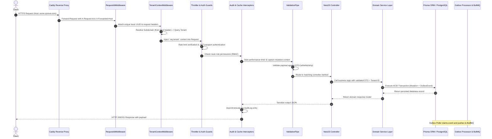
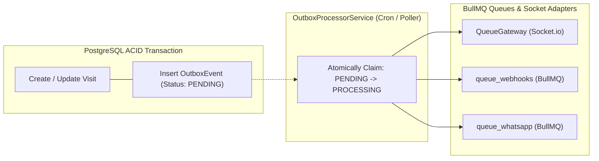

# End-to-End System Architecture & Topology

## 1. System Architecture Topology

The Qmova platform operates as a modern distributed web application separating edge client delivery, centralized application runtime, asynchronous task processing, in-memory state caching, and persistent relational storage.

```
                              [ Public Internet / Clients ]
                                             │
                       ┌─────────────────────┴─────────────────────┐
                       │                                           │
                 [ Browser App ]                             [ Mobile / Kiosk / TV ]
                       │                                           │
                       └─────────────────────┬─────────────────────┘
                                             │  HTTPS / WSS (Ports 80/443)
                                             ▼
                                    ┌─────────────────┐
                                    │  Reverse Proxy  │
                                    │ (Caddy / Nginx) │
                                    └────────┬────────┘
                                             │
                 ┌───────────────────────────┴───────────────────────────┐
                 │                                                       │
                 ▼ (Port 3001)                                           ▼ (Port 3000)
    ┌──────────────────────────┐                            ┌──────────────────────────┐
    │     Next.js Frontend     │                            │      NestJS Backend      │
    │ (Pages Router + SSR/SSG) │                            │    (REST + WebSockets)   │
    └────────────┬─────────────┘                            └────────────┬─────────────┘
                 │                                                       │
                 │ Next API proxy                                        ├───────────────────────────────┐
                 └───────────────────────────────────────────────────────┤                               │
                                                                         ▼                               ▼
                                                            ┌────────────────────────┐      ┌────────────────────────┐
                                                            │     PostgreSQL 15+     │      │      Redis 7+          │
                                                            │      (Prisma ORM)      │      │  (Cache/PubSub/Queues) │
                                                            └────────────────────────┘      └────────────┬───────────┘
                                                                                                         │
                                                                                            ┌────────────┴───────────┐
                                                                                            ▼                        ▼
                                                                                     ┌─────────────┐          ┌─────────────┐
                                                                                     │   BullMQ    │          │  Socket.io  │
                                                                                     │ Background  │          │  Broadcast  │
                                                                                     │   Workers   │          │   Adapter   │
                                                                                     └─────────────┘          └─────────────┘
```

---

## 2. Infrastructure & Runtime Components

| Component | Technology | Role & Configuration |
| :--- | :--- | :--- |
| **Edge Web Server** | Caddy / Nginx | TLS termination, HTTP/2 & WebSocket upgrade proxy, automatic Let's Encrypt certificates, gzip/brotli compression. |
| **Frontend Framework** | Next.js 14+ (Pages Router) | Edge routing middleware, dynamic tenant rewrites, React Query state hydration, PWA service worker. |
| **Backend Framework** | NestJS 10+ (Express HTTP) | Modular architecture, dependency injection, global exception filters, Pino structured logging, Sentry profiling. |
| **Database Engine** | PostgreSQL 15 | Relational data persistence, foreign key constraints, ACID transactions, row-level concurrency control. |
| **Database Access** | Prisma ORM 5.x | Type-safe schema definition, migration generation, query composition, connection pooling. |
| **In-Memory Store** | Redis 7+ | Real-time token sequencing (`INCR`), Socket.io multi-node adapter, BullMQ backing store, HTTP response caching. |
| **Job Queue Engine** | BullMQ | Asynchronous webhook delivery, WhatsApp notification queues, transactional outbox dispatching, dead-letter retries. |
| **Telemetry & Observability** | Sentry & Pino | Distributed tracing, profile sampling, request-id propagation, automated unhandled exception capture. |

---

## 3. Request Lifecycle & Execution Pipeline

Every HTTP request entering the backend runtime traverses a deterministic multi-stage NestJS pipeline:



### Stage Details
1. **`RequestIdMiddleware`**: Extracts `x-request-id` or generates a cryptographically random UUID (`crypto.randomUUID()`), binding it to both request logger and downstream responses for end-to-end trace correlation.
2. **`TenantContextMiddleware`**: Parses the incoming `host` header. If it detects a non-system subdomain (excluding `api`, `app`, `www`), it fetches and attaches the `Tenant` database object to `req.tenant`.
3. **`ThrottlerGuard`**: Evaluates rate-limiting counters in Redis (default: 100 requests / 60 seconds per IP) to mitigate denial-of-service and brute-force threats.
4. **`AuthGuard('jwt')` & `RolesGuard`**: Decodes the HTTP-only cookie or `Authorization: Bearer <token>` JWT, verifies signature, extracts user payload (`userId`, `tenantId`, `role`), and checks role entitlements against `@Roles(Role.ADMIN, ...)`.
5. **`ValidationPipe`**: Enforces strict payload contracts (`whitelist: true`, `forbidNonWhitelisted: true`), transforming incoming raw JSON into validated TypeScript class instances.
6. **`AuditInterceptor`**: Inspects outgoing status and payload, recording audit logs (`AuditLog` entity) capturing `userId`, `tenantId`, `action`, `resource`, `ipAddress`, and timestamp.
7. **`AllExceptionsFilter`**: Catches unhandled runtime exceptions, formats standardized error envelopes (`{ statusCode, message, error, timestamp, path }`), and flushes trace contexts to Sentry.

---

## 4. Transactional Outbox & Event Architecture

To prevent distributed dual-write inconsistencies (e.g., database updates succeeding while WebSocket broadcasts or WhatsApp webhooks fail), Qmova implements the **Transactional Outbox Pattern**:



1. **Atomic Insertion**: When a visit is created, called, transferred, or completed, an `OutboxEvent` record is inserted within the exact same database transaction as the `Visit` state mutation.
2. **Atomic Claiming**: `OutboxProcessorService` queries for events with `status = 'PENDING'`. It executes a targeted batch update (`status = 'PROCESSING'`) to prevent race conditions across multi-instance clusters.
3. **Queue Distribution**:
   - `VISIT_CREATED`, `VISIT_CALLED`, `VISIT_COMPLETED` trigger instant WebSocket broadcast emissions to operator rooms and digital signage TV displays.
   - External webhooks are enqueued into BullMQ `queue_webhooks` with exponential backoff retries.
   - WhatsApp message dispatches are enqueued into BullMQ `queue_whatsapp` to prevent external rate-limit throttling from slowing down customer transactions.
4. **Completion & Archival**: Once dispatched, the event is marked `status = 'COMPLETED'`. A scheduled cron job (`handleOutboxRetention`) purges events older than 7 days.

---

## 5. Real-Time Synchronization Topology

Qmova utilizes a dual real-time architecture optimized for differing client constraints:

### 1. WebSockets (Socket.io + Redis Adapter)
- **Target Surfaces**: Staff `Service Desk`, operator `My Desk`, and waiting room TV screens (`/tv/[tenantId]`).
- **Connection Model**: Bidirectional, stateful connection authenticated via JWT or tenant token.
- **Scaling Mechanism**: Multi-server synchronization powered by `RedisIoAdapter`. When a visit is called on Server A, Redis Pub/Sub propagates the broadcast to Server B, alerting connected TV screens and staff terminals instantly.
- **Events Emitted**: `visit:created`, `visit:called`, `visit:transferred`, `visit:completed`, `queue:updated`, `notification:sound`.

### 2. Server-Sent Events (SSE)
- **Target Surfaces**: Public customer mobile wait screen (`/customer/status/[id]`).
- **Connection Model**: Unidirectional, HTTP-native stream (`GET /public-visit/stream?tokens=...`).
- **Resilience Design**:
  - Automatically reconnects over cellular connections without complex handshake negotiations.
  - Periodic heartbeat stream (`interval(15000)`) emits `:heartbeat` comment frames to prevent reverse proxies (Caddy/Nginx) from severing idle connections after 60 seconds.
  - Seamlessly falls back to client-side polling (`staleTime: 5000`) if SSE connections are blocked by enterprise firewalls.

