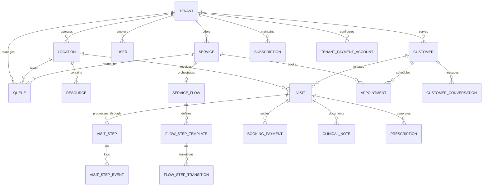

# Domain Data Models & Database Schema Audit

## 1. Domain Model Overview

The Qmova database schema is maintained in PostgreSQL via Prisma ORM (`backend/prisma/schema.prisma`). It defines **55 distinct relational models** and **18 enumerated types**, covering physical facilities, dynamic service workflows, real-time queues, clinical documentation, digital retail catalogs, omnichannel messaging, and multi-currency billing.

---

## 2. Core Domain Model Taxonomies

### A. Multitenancy, Identity & RBAC
- **`Tenant`**: Root organizational entity. Stores company name, unique subdomain, custom domain, status (`TRIAL`, `ACTIVE`, `SUSPENDED`), branding tokens (logo, theme color, font, custom CSS), operational settings (business hours, timezone, currency, address), and WhatsApp connection metadata (`whatsappInstanceId`, `whatsappConnected`).
- **`User`**: Staff or administrative account. Tied to a single tenant (`tenantId`). Encapsulates authentication credentials (hashed password, salt), active profile, and role classification:
  - `SUPER_ADMIN`: Global platform operator.
  - `OWNER`: Tenant account creator and legal entity owner.
  - `ADMIN`: Tenant administrator managing settings, billing, and team.
  - `MANAGER`: Operations lead managing locations, queues, and schedules.
  - `STAFF`: Counter operator, service provider, or clinician.
- **`UserSession`**: Tracks active authenticated sessions, JWT tokens, IP addresses, user agents, and revocation status for security compliance.
- **`Invitation`**: Secure team onboarding token. Configured with role, email, expiration date, maximum uses, and one-click acceptance links.
- **`AuditLog`**: Tamper-evident ledger capturing all state-altering administrative actions (`action`, `resource`, `resourceId`, `userId`, `ipAddress`, `metadata`).
- **`SystemLog`**: Application-level error and debug logging table queryable by Super Admin.

### B. Physical Hierarchy & Facilities
- **`Location`**: Physical branch, clinic site, or store. Configured with latitude/longitude for geofencing, timezone, localized operating hours, phone, and default display prefixes.
- **`Resource`**: Physical asset required to deliver a service (e.g., "Consultation Room 3", "Dental Chair B", "Service Bay 4", "Table 12"). Has capacity limits and location binding.
- **`Staff`**: Operational provider record linked to a `User`. Holds title, specialization, location assignment, active status, and working hour schedules.
- **`BlockOff`**: Calendar blocking mechanism used to schedule maintenance, staff leaves, lunch breaks, or emergency closures.

### C. Services & Multi-Stage Journey Engine
- **`Service`**: Specific offering (e.g., "General Doctor Consultation", "Full Haircut & Wash", "Vehicle Diagnostic Test"). Defines base price, duration, buffer times, payment mode (`PREPAY`, `POSTPAY`, `OPTIONAL_PREPAY`, `PAY_AT_SERVICE`), and SLA threshold.
- **`ServiceFlow`**: Defines the workflow blueprint for a service. Contains operational modes (`paymentTiming`, `checkinPayMode`, `isActive`).
- **`FlowStepTemplate`**: Blueprint step within a service flow. Encapsulates:
  - `stepType`: `SERVICE`, `CHECKPOINT`, `COLLECTION`, `WAITING_PERIOD`, `NOTIFICATION`, `PAYMENT`, `FORM`, `CHECK_IN`, `CHECK_OUT`, `ORDER`.
  - `trigger`: `AUTOMATIC`, `MANUAL_STAFF`, `MANUAL_CUSTOMER`, `SCHEDULED`, `CONDITION`.
  - Location attributes: `floorNumber`, `roomNumber`, `buildingWing`, `locationDescription`.
  - Financial attributes: `stepPrice`, `stepPriceCurrency`, `isPriceVariable`.
  - Dynamic Form UI configurations and digital menu order items.
- **`FlowStepTransition`**: Directed graph defining allowed movement between step templates.
- **`VisitStep`**: Live, instantiated execution of a `FlowStepTemplate` for an active customer visit. Tracks `status` (`LOCKED`, `PENDING`, `QUEUED`, `ACTIVE`, `DONE`, `SKIPPED`, `EXPIRED`, `FAILED`), timestamps, assigned staff, and outcome data.
- **`VisitStepEvent`**: Fine-grained audit trail of step lifecycle actions (`QR_SCANNED`, `ENTITLEMENT_REDEEMED`, `PAYMENT_MADE`, `ORDER_SUBMITTED`).

### D. Queues, Appointments & Live Visits
- **`Queue`**: Virtual waiting line tied to a location and one or more services. Configures token prefix (e.g., "A", "DOC", "VIP"), priority weighting, maximum capacity, status (`ACTIVE`, `PAUSED`, `CLOSED`), and daily sequence counters.
- **`Customer`**: CRM record storing customer name, phone number (E.164 normalized), email, notes, and visit history.
- **`Visit`**: The central operational record in the SaaS. Represents a physical customer visit or remote queue entry:
  - `displayId`: Customer token number (e.g., "A042").
  - `accessToken`: Cryptographically secure UUID enabling public client access without authentication.
  - `currentState`: `CREATED`, `SCHEDULED`, `CHECKED_IN`, `WAITING`, `CALLED`, `ASSIGNED`, `IN_SERVICE`, `COMPLETED`, `CANCELLED`, `NO_SHOW`, `MISSED`, `ON_HOLD`, `ABANDONED`, `TRANSFERRED`, `PENDING_PAYMENT`.
  - `source`: `APPOINTMENT`, `WALK_IN`, `WEBSITE`, `WHATSAPP`, `PHONE`, `RECEPTION`, `KIOSK`, `QR`, `API`.
  - Tracking timestamps: `waitingStart`, `calledAt`, `startedAt`, `completedAt`.
  - Rating & Feedback: `rating` (1–5 stars), `feedbackText`.
- **`Appointment`**: Scheduled future calendar booking. Stores `startTime`, `endTime`, `status`, external calendar sync IDs (`GoogleIntegration`), and reminders sent.

### E. Clinical & Specialized Industry Models
- **`ClinicalNote`**: Encrypted medical consultation record tied to a `Visit`. Captures SOAP notes (Subjective, Objective, Assessment, Plan), diagnosis codes, and attending clinician notes.
- **`Prescription`**: Medication and dosage instructions issued during a visit with fulfillment status.
- **`PatientMedicalProfile`**: Long-term medical record storing allergies, chronic conditions, and emergency contacts.
- **`ServiceCatalog` & `ServiceCatalogItem`**: Menu and retail catalog management enabling restaurants, salons, and clinics to sell food, drinks, or products directly through the queue wait screen.

### F. Payments, Invoicing & Subscriptions
- **`Plan`**: SaaS subscription plan tier (e.g., "Starter", "Standard", "Premium", "Enterprise"). Defines prices, quotas (`maxTokens`, `maxLocations`, `maxServices`, `maxStaff`), and feature flags.
- **`Subscription`**: Active tenant SaaS subscription. Tracks period dates, status (`TRIAL`, `ACTIVE`, `PAST_DUE`), cancellation flags, and current quotas.
- **`TenantPaymentAccount`**: Stores connected Stripe Connect account ID (`connectedAccountId`) and Paystack subaccount details (`subaccountCode`, bank verification).
- **`BookingPayment`**: Customer transaction record for service deposits, ticket purchases, or counter payments. Tracks provider, gateway IDs, payment method (`STRIPE_ONLINE`, `CASH`, `CARD_TERMINAL`, `EFT`), and status.
- **`VisitInvoice` & `Invoice`**: Official tax invoices generated for visits and SaaS subscriptions with PDF export capabilities.

### G. Communications & Omnichannel Messaging
- **`CustomerConversation` & `Message`**: 2-way omnichannel chat thread connecting receptionists with customers over WhatsApp or SMS.
- **`WhatsAppTemplate`**: Pre-approved messaging templates for notifications, arrival reminders, and OTPs.
- **`CommunicationLog`**: Comprehensive delivery log recording provider responses, delivery status, and retry counts.

---

## 3. Concurrency, Locking & Data Integrity

1. **Atomic Token Sequencing**: Rather than relying on slow, lock-heavy SQL `SELECT MAX() + 1` queries, daily queue token counters use atomic Redis `INCR` commands (`queue:token_seq:{locationId}:{prefix}:{dateStr}`) with 48-hour expiration keys.
2. **ACID Transaction Boundaries**: All composite operations (e.g., joining a queue, creating customer record, generating token, checking plan quota, instantiating journey steps, creating outbox event) execute inside a single Prisma `$transaction(async (tx) => { ... })` block. If any step fails, the entire transaction rolls back cleanly.
3. **Optimistic Locking on State Transitions**: State transitions on visits (`WAITING` → `CALLED`) verify current state in the `where` clause to prevent two operators from calling the same customer simultaneously.

